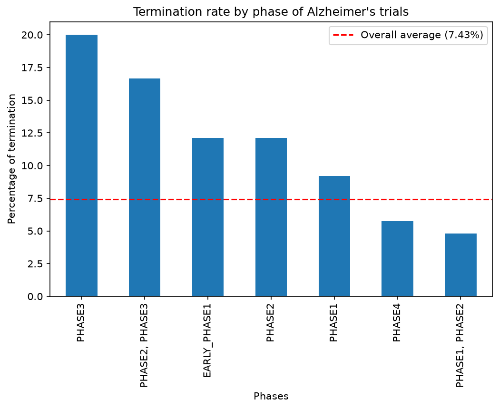
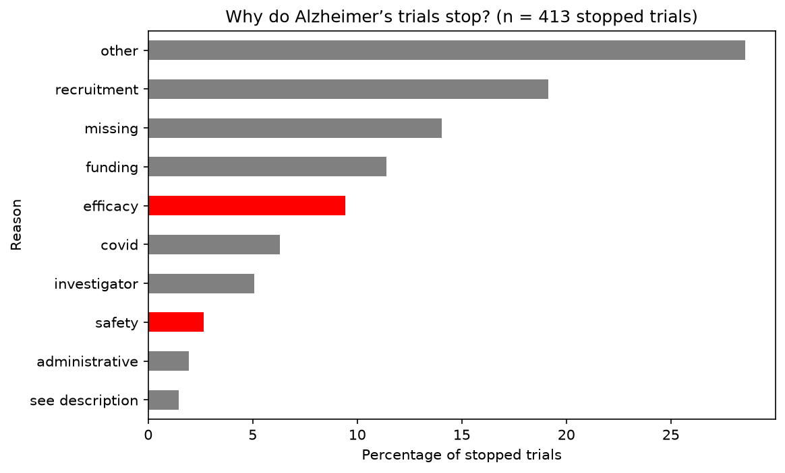
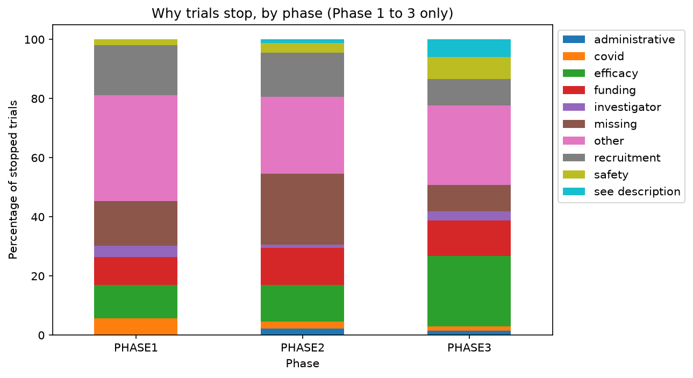

# Why do Alzheimer's clinical trials stop?

An analysis of 4,092 Alzheimer's clinical trials from ClinicalTrials.gov: what happens to them, which ones get terminated and why.

**TL;DR:** Phase 3 trials get terminated almost 3 times more often than average (20% vs 7.43%), but most stopped trials don't stop because the drug failed. Only about 12% stop for efficacy or safety reasons, while about 44% stop for practical reasons like not finding enough patients or running out of money.

## Motivation
I started this project because someone in my family was diagnosed with Alzheimer's, and I wanted to understand why so few treatments make it through trials. This is the first part of a bigger project: the findings here will be used as features for a model that predicts whether a trial gets terminated early.

## Key findings

### 1. Phase 3 trials get terminated the most
7.43% of all trials are terminated, but in Phase 3 it's 20% and in Phase 2 12.11%.



### 2. Most trials don't stop because the drug failed
Out of 413 stopped trials (terminated, withdrawn or suspended), only about 12% stopped because of efficacy or safety (in red). About 44% stopped for practical reasons like recruitment problems, funding or COVID.



### 3. The drug not working is mainly a late-stage problem
Efficacy grows as a reason from Phase 1 to Phase 3, where it's the most common named reason (24% of stopped Phase 3 trials).



More charts: [status of all trials](figures/01_status.png) and [trials per phase](figures/02_phases.png).

## Fixes: stricter termination rates
Originally I calculated termination rates over every registered trial, including ones that are still running and haven't had the chance to stop yet. In `07_fixes` I redid it only on trials that actually ended (COMPLETED or TERMINATED).

| | All registered | Finished only |
|---|---|---|
| Phase 3 | 20.0% | 26.8% |
| All trials | 7.41% | 12.2% |

Phase 3 is still the worst in both. A chi-square test on finished trials shows that termination rate really depends on phase (p < 0.001), so the difference is not just chance.

The counts are slightly different from the original analysis (4,100 trials now vs 4,092) because the data was downloaded again and new trials had been registered.

## Data
- **Source:** [ClinicalTrials.gov API v2](https://clinicaltrials.gov/data-api/api), all trials with Alzheimer's as a condition
- **Size:** 4,092 trials, downloaded in November 2026 (the numbers change as new trials get registered)
- The data isn't stored in the repo, the first notebook downloads it

## Approach
1. **Download:** all trials page by page through the API (1,000 per page, using `nextPageToken`)
2. **Flatten:** each trial is a deeply nested JSON, turned into one row with the fields I need
3. **Data quality:** checked missing values and fixed the column types before any analysis
4. **Analysis:** status, phases and termination rate per phase
5. **Why trials stop:** sorted the free-text reasons into categories with keyword rules

### Decisions I made
- **Rates instead of counts:** Phase 2 has almost twice as many trials as Phase 3, so counting terminations would be unfair. Rates compare phases of different sizes.
- **"Stopped" means terminated, withdrawn and suspended**, not only terminated (304 → 413 trials).
- **The order of the categories matters:** a reason like "sponsor decision due to safety concerns" matches two categories, so specific reasons (efficacy, safety) are checked before vague ones (sponsor). Otherwise funding would look bigger than it really is.
- **Dates with only year and month** (like 2015-09) got the 15th, so they're never more than about 15 days off, instead of dropping those trials.
- **Missing why_stopped looked like 91%**, but that's misleading because most trials never stopped. Among terminated trials only 14.8% have no reason.

## Project structure
```
clinical-trials-explorer/
├── data/
│   ├── raw/              # downloaded JSON (not in the repo)
│   └── processed/        # flattened CSV (not in the repo)
├── figures/              # the 5 charts
├── notebooks/
│   ├── 01_api_exploration.ipynb
│   ├── 02_build_table.ipynb
│   ├── 03_data_quality.ipynb
│   ├── 04_status_phase.ipynb
│   ├── 05_why_stopped.ipynb
│   ├── 06_charts.ipynb
│   └── 07_fixes.ipynb
├── src/
│   ├── download.py       # downloads all trials from the API
│   ├── flatten.py        # turns the JSON into a table
│   ├── fixed_data.py     # fixes column types
│   └── analysis.py       # termination rates and reason categories
└── requirements.txt
```

## How to run
```bash
git clone https://github.com/george1234560/clinical-trials-explorer.git
cd clinical-trials-explorer
python -m venv venv
venv\Scripts\activate        # on Mac/Linux: source venv/bin/activate
pip install -r requirements.txt
```
Then run the notebooks in order, starting from `01` (it downloads the data) and `02` (it builds the table the others use).

**Built with:** Python, pandas, matplotlib, scipy, requests

## Limitations
- The reasons for stopping are free text, so they were sorted with keyword matching. 29% still end up as "other" and reasons written indirectly get missed, so efficacy and safety are probably undercounted.
- 14% of stopped trials give no reason at all.
- Some phases have very few stopped trials (for example 13 in Phase 4), so their percentages aren't reliable.
- "Terminated" doesn't always mean the drug failed, and the data is a snapshot that changes over time.

## Next steps
- Use these findings (phase, sponsor type, enrollment, reasons) as features for a model that predicts early termination
- Compare Alzheimer's with other diseases like Parkinson's